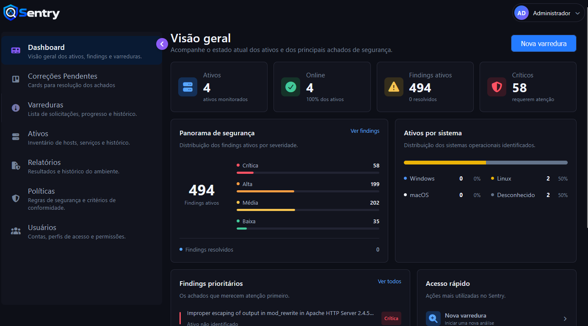
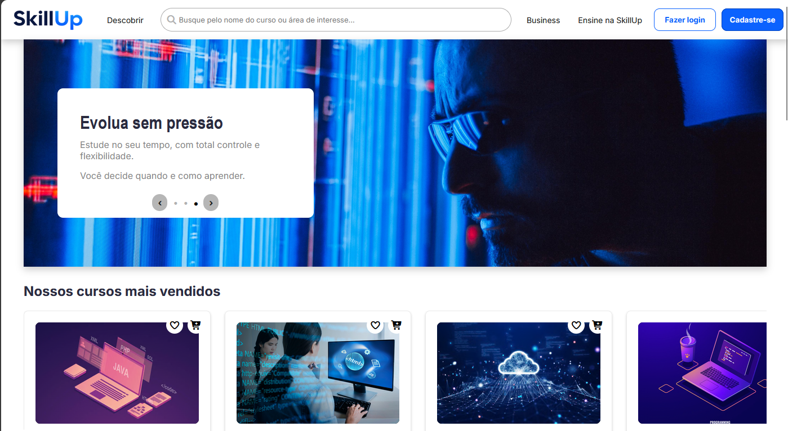

<div align="center">


<a href="https://git.io/typing-svg"></a>

<br/>

[](https://www.linkedin.com/in/gustavoolsantos/)
[](mailto:contato@gustavoolsantos.dev.br)
[](https://www.gustavoolsantos.dev.br/)

</div>

<br/>

## Sobre mim

```java
public class Gustavo implements Developer {

    private final String[] stack = {"Java", "Spring Boot", "React", "JavaScript", "PHP"};
    private final String[] tools = {"VScode", "Cypress", "Docker", "RabbitMQ", "CI/CD", "AI"};
    private final String focus   = "Backend-focused Full Stack";
    private final String[] experience = {"BNDES", "Serpro", "Riex"};

    @Override
    public String[] currentlyLearning() {
        return new String[]{"Microservices"};
    }
}
```

Desenvolvedor Full Stack com foco em Back-end Java, atuando no desenvolvimento e manutenção de aplicações corporativas, APIs REST e integrações entre sistemas. Tenho experiência com Java, Spring Boot, Spring Security, JPA/Hibernate e React, além de automação de processos, testes automatizados e CI/CD.

Atualmente, trabalho com desenvolvimento de sistemas no BNDES, após experiências no SERPRO e em projetos de desenvolvimento e automação na Riex. Nessas experiências, participei da manutenção de sistemas em produção, otimização de consultas SQL, integração de serviços, automação de processos e implementação de testes E2E com Cypress.

Sou estudante de Ciência da Computação na Universidade Veiga de Almeida e técnico em Automação Industrial pelo CEFET/RJ. Tenho interesse em engenharia de software, arquitetura de sistemas e desenvolvimento de soluções que resolvam problemas reais.

Atualmente, desenvolvo projetos próprios utilizando Java, Spring Boot e React, com destaque para o Sentry e o Skill Up.

<br/>

## Tech Stack

<div align="left">

### Backend  
### Frontend 
### Bancos de Dados 
### Mensageria 
### Testes     
### DevOps e ferramentas 

</div>

<br/>

## Projetos em destaque

### [Sentry — Plataforma de Gestão de Vulnerabilidades](https://github.com/GustavoOlSantos/sentry)

Aplicação full stack voltada à descoberta de ativos e serviços de rede, identificação de vulnerabilidades e avaliação de configurações de segurança.



- **Backend:** Java e Spring Boot, com APIs REST para gerenciamento de varreduras, ativos e findings.
- **Varredura e análise:** integração com Nmap para descoberta de hosts e serviços, consulta à base NVD para identificação de vulnerabilidades associadas a CVEs e verificações automatizadas de configurações.
- **Mensageria:** RabbitMQ para processamento assíncrono das solicitações de varredura.
- **Frontend:** React para visualização e gerenciamento dos resultados.
- **Infraestrutura:** Docker e Docker Compose para execução dos serviços e ambiente de laboratório.

<p>
  <a href="https://github.com/GustavoOlSantos/sentry">
    
  </a>
  <a href="https://github.com/GustavoOlSantos/sentry#readme">
    
  </a>
</p>

### [SkillUp — Plataforma de Cursos Online](https://github.com/GustavoOlSantos/skill-up)

Plataforma EAD full stack com funcionalidades de gerenciamento de cursos, matrículas, reprodução de aulas e avaliações de usuários.



- **Backend:** Java 21 e Spring Boot, com APIs REST, autenticação e autorização utilizando Spring Security e JWT.
- **Persistência:** MySQL para cursos, categorias e compras; MongoDB para avaliações.
- **Frontend:** React e Cloudinary para hospedagem de imagens.
- **CI/CD:** GitHub Actions com build paralelo de frontend e backend, testes E2E com Cypress, seed automatizado de banco de dados, análise estática e verificações de segurança.
- **Observabilidade:** logging estruturado com Logback e Logstash Encoder, com configurações específicas para os ambientes local e produção.
- **Performance:** identificação e correção de um gargalo que gerava mais de 16 requisições individuais para carregar avaliações, substituindo-as por uma consulta consolidada em um único endpoint. Utilização de `Collectors.teeing` para processamento combinado dos dados e cache de aplicação em endpoints com baixa necessidade de atualização em tempo real.

<p>
  <a href="https://github.com/GustavoOlSantos/skill-up">
    
  </a>
  <a href="https://skillup.gustavoolsantos.dev.br/">
    
  </a>
  <a href="https://github.com/GustavoOlSantos/skill-up#readme">
    
  </a>
</p>

<br/>

## GitHub Stats

<div align="center">
  
  
</div>

<div align="center">
  
</div>

<br/>

## Vamos conversar

<div align="center">

Estou sempre aberto a trocar ideia sobre backend, arquitetura de sistemas ou boas práticas de engenharia.

[](https://www.linkedin.com/in/gustavoolsantos/)
[](mailto:contato@gustavoolsantos.dev.br)

<sub>⭐ Se algum projeto aqui te interessou, deixa uma estrela!</sub>

</div>
